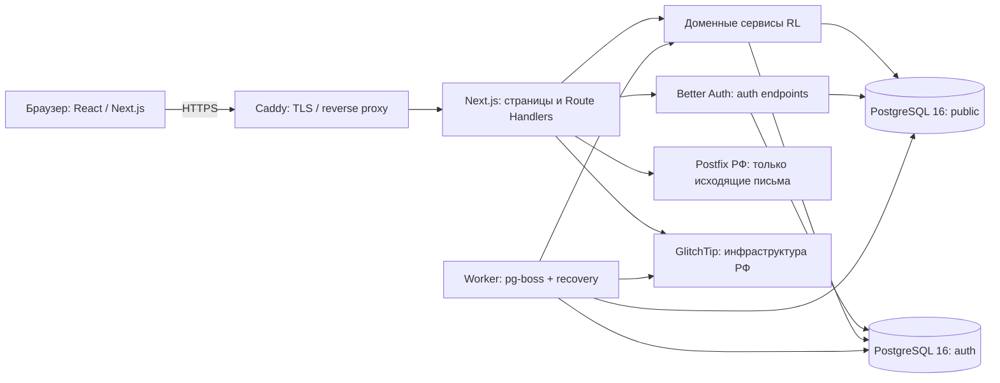

# RL — Архитектурные решения и технический фундамент v1.3

**Проект:** Russian_lang (RL)  
**Редакция:** 1.3  
**Дата:** 13.11.2026  
**Статус:** согласованный технический документ волны 0. В редакции 1.3 добавлены правила Git/CI/CD и целевая модель DEMO без разрешения на фактическое развертывание. `DEC-05` фиксирует принятое почтовое решение, но доставка остаётся `VERIFY`. Иные `PROPOSED`, `VERIFY`, `BLOCKED` не изменены. Документ дополняет нормативный пакет RL v9.8.  
**Базовая редакция требований:** RL v9.8; почтовая поправка к стеку фиксируется отдельной редакцией комплекта и `ADR-004`.  
**Назначение:** однозначно определить границы компонентов, технические решения и проверки до постановки AI-агентам задач на реализацию первой очереди.

> **Важное правило применения:** этот документ конкретизирует техническую реализацию **в пределах** утверждённой v9.8 с явно принятым изменением почтового направления `DEC-05`. В нём различаются ранее утверждённые требования (`FIXED`), рекомендуемые технические решения (`PROPOSED`), проверяемые гипотезы (`VERIFY`) и вопросы, без закрытия которых запрещено выполнять зависимую работу (`BLOCKED`). Согласование настоящей редакции **не означает автоматического утверждения** отдельных решений со статусами `PROPOSED` или `VERIFY` и не закрывает `BLOCKED`. Иерархию источников см. §1.1 и дополнение к `AGENTS.md`.

**Изменения редакции 1.3 относительно 1.2 (13.11.2026):** принят рабочий регламент `RL_Git_CI-CD_и_окружения_v1.1.md` и узкое ТЗ `RL_W0-11_GitHub_CI_ТЗ_v1.1.md`. Уточнены различия локального Git (W0-01), GitHub/CI (W0-11), DEMO и PROD, правила выпуска одного Docker image по digest, approvals и границы полномочий AI-агентов. DEMO описана как целевая среда, **не** как уже выделенный сервер, и не означает утверждения `DEC-10/11/12`. Продуктовые UC, ER, версии технологического стека, схема почты и статусы DEC не изменены.

**Изменения редакции 1.2 относительно 1.1:** заказчиком принят собственный Postfix в Docker на VPS в РФ для исходящей почты и Mailpit локально; Dovecot/IMAP/POP3 и приём входящей почты исключены. `DEC-05` переведён в `FIXED`, но реальная доставка, DNS, IP-ограничения, возвраты/отказы и интеграция Better Auth остаются `VERIFY` в W0-08. Уточнены §2, §9.1, §11.3, §12.1, W0-08 и порог WAVE0_ACCEPTED; остальные DEC не меняются. Архитектура теперь ссылается на нормативный пакет RL v9.8.

**История редакции 1.1 относительно 1.0 (только согласование документации):** установлено единственное соответствие DEC → ADR в §12.1; критерий §13.2 распространён на все шесть ADR; §6.2 отсылает к нормативному алгоритму повторов без самостоятельных числовых интервалов; ссылки `ADR-01/02` приведены к `ADR-001/002`. Отдельно обновлена инструкция `AGENTS.md` для волны 0. Продуктовые требования RL v9.7, состав технологий и состояния DEC в редакции 1.1 не менялись.

---

## 1. Границы и нормативные источники

### 1.1. Иерархия документов

| Файл пакета v9.8 | Что определяет |
|---|---|
| `RL_Общая_концепция_v9.8.md` | Принципы продукта, аудитория, границы первой очереди |
| `RL_Use_Cases_v9.8.md` | Нормативное пользовательское поведение, права и критерии приёмки |
| `RL_ER-сущности_v9.8.md` | Состав и семантика данных, алгоритмы, типы, FK, CHECK, индексы |
| `RL_Стек_v9.8.md` | Согласованные компоненты и версии |
| `RL_Функциональная_декомпозиция_v9.8.md` | Модули F01–F12, приоритеты и волны работ |
| `RL_Удаление_данных_и_проверка_FK_v9.8.md` | Нормативный порядок UC-36/37, тесты Dxx/PG-xx |
| `AGENTS.md` | Правила поведения AI-разработчика; не источник новых продуктовых требований |
| `RL_FK_audit_PostgreSQL_v9.8.sql` | Вспомогательный SQL-аудит фактических FK, не миграция и не замена тестам |
| `RL_Git_CI-CD_и_окружения_v1.1.md` | Дополнительная рабочая политика Git, CI, релизных образов и будущих DEMO/PROD, не изменение продуктовых норм |
| `RL_W0-11_GitHub_CI_ТЗ_v1.1.md` | Узкое исполнимое ТЗ на GitHub/CI в рамках существующего W0-11, не требование W0-01 |

**При конфликте:** AI-агент обязан остановить только конфликтующий участок, привести точные выдержки и последствия, предложить решение и получить утверждение. Этот документ не имеет права «победить» нормативные UC/ER/стек. Исторические changelog и diff ER справочные.

### 1.2. Что входит в технический фундамент волны 0

1. Зафиксированная архитектура процессов, каталог модулей и границы данных.
2. Воспроизводимое локальное окружение Next.js / PostgreSQL / pg-boss в Docker Compose с установленными точными версиями пакетов.
3. Проверенный интеграционный прототип Better Auth + Prisma + PostgreSQL с двумя схемами и подтверждёнными OAuth-потоками.
4. Проверенный способ завершения RL-регистрации и защиты от входа с незавершённым профилем.
5. Испытание фоновых задач, их повторного исполнения и восстановления после сбоя — особенно для будущих UC-36/37.
6. Выбор и одобрение поставщика транзакционных писем, рабочая доставка подтверждения email и сброса пароля.
7. Утверждение конкретных порогов минимального security rate limiting и проверка их исполнения.
8. Репозиторий, автоматические проверки качества, схема конфигурации, секретов и базовые правила эксплуатации.
9. Протокол технических решений и отчёт о завершении волны 0.

**Не входит как обязательный результат волны 0:** полная реализация UC-02…UC-40, все экраны, содержимое дерева правил, парсер диктантов, весь алгоритм прогресса, полный набор итоговых миграций ER, UI-редактор и полноценная продуктивная инфраструктура. Они выполняются в соответствующих волнах. Фундамент обязан *не блокировать* их реализацию.

### 1.3. Неподлежащие пересмотру ограничения (FIXED)

- Одно модульное приложение на **Next.js**, без микросервисов и Kubernetes; отдельный процесс фоновых задач допустим как способ исполнения того же кода.
- Node.js **24 LTS**, TypeScript **5.9.x** (`strict: true`), Next.js **не ниже 16.4.1** в пределах принятой линии 16.4.x, PostgreSQL **16**, Prisma **7.8**, Better Auth **1.7.x** (точный patch — после спайка), pg-boss **12.38** (точный patch фиксируется), Vitest **5.0**, Playwright **1.64**. Полный перечень — только в `RL_Стек_v9.8.md`.
- Одна физическая база PostgreSQL с утверждёнными прикладными схемами `auth` (Better Auth) и `public` (RL), без Redis/BullMQ для RL.
- Публичное приложение адаптивно для смартфонов и компьютеров; PWA, Service Worker и офлайн-режим в первую очередь не входят.
- Только русский интерфейс, без i18n и без неоправданных высоконагрузочных механизмов.
- Сервер — единственный доверенный источник прав, разрешённых операций, состояний тренировок и результатов.
- Все данные RL, включая БД, резервные копии, прикладные логи и мониторинг, размещаются в РФ. Внешние интеграции проверяются отдельно на фактические потоки данных.
- `is_founder_admin=true` защищён на уровне бизнес-операций **и PostgreSQL**; штатное удаление, обезличивание, блокировка и снятие admin-роли запрещены.
- Удаление аккаунта двухфазное: транзакция RL и затем идемпотентная очистка Better Auth, с восстановлением заданий по `user_deletion_jobs`.
- Применять только согласованные технологии; самостоятельное изменение бизнес-правил агентом запрещено.

## 2. Архитектура верхнего уровня

### 2.1. Стиль: модульный монолит

**Рекомендуемое архитектурное решение ADR-001 — `PROPOSED`, не изменяет стек.**

RL — один репозиторий и один Next.js-продукт с чёткими внутренними модулями. HTTP-запросы обрабатывает веб-процесс; запланированные задачи выполняет отдельный процесс *из того же репозитория/образа*, использующий общие доменные сервисы и Prisma-клиент. Это не микросервисы: нет сетевого API между веб- и worker-процессом, отдельных доменных БД и распределённых транзакций.



**Уточнение диаграммы:** `D` и `H` — схемы **одной** физической базы, не две БД. Между RL и Better Auth возможны отдельные транзакционные границы; общая PostgreSQL сама по себе **не доказывает**, что весь библиотечный сценарий исполняется в общей Prisma-транзакции. Для GlitchTip требуется собственное изолированное хранилище в РФ; оно не должно создавать таблицы в RL-базе без явного отдельного решения.

### 2.2. Границы компонентов

| Компонент | Ответственность | Чего не делает |
|---|---|---|
| Next.js App Router | Страницы, маршрутизация, серверный рендеринг, формирование HTTP-ответов | Не владеет алгоритмами и правами как самостоятельным источником истины |
| Route Handlers `/api/...` | HTTP-контракты, Zod-валидация, получение сессии, вызов бизнес-сервиса, формирование ошибок | Не реализуют сложные операции через прямой разрозненный Prisma-доступ |
| Доменные сервисы `src/server/modules/*` | Правила UC: доступ, операции, транзакции, инварианты, идемпотентность | Не зависят от React и конкретной страницы |
| Better Auth | Сеансы, credentials, email verification, OAuth, пароль, операции авторизации | Не определяет роль RL, собственность контента, состояние удаления и право founder |
| Prisma + SQL миграции | Операции с данными, транзакции, индексы и физические ограничения | Не заменяет PostgreSQL CHECK/триггеры |
| pg-boss worker | Плановое исполнение, повторы и обработка задач | Не является единственным источником состояния удаления |
| Caddy | HTTPS, обратное проксирование, необходимая настройка доверенных заголовков | Не считается достаточной серверной авторизацией |
| pino / OpenTelemetry / GlitchTip | Диагностика, показатели работоспособности, журналирование очищенных событий | Не получают raw токены, пароли, тексты с PII по умолчанию |
| Собственный Postfix (исходящий SMTP, VPS в РФ) | Доставка транзакционных писем; Mailpit — только локальные тесты | Нет входящей почты, Dovecot/IMAP/POP3; не становится источником идентичности |

### 2.3. Единая бизнес-операция для веба и будущего API

Операция определена в доменном сервисе, например `publishDictationVersion()`; пользовательский интерфейс и будущий мобильный API обращаются к ней через разные адаптеры. Это сохраняет возможность будущего мобильного приложения без дублирования алгоритмов. На волне 0 создавать *только каркас и образцовый вертикальный срез*, а не заглушки всех 40 UC.

Данные от клиента всегда считаются недоверенными. ID пользователя определяется по серверной сессии и таблице `user_profile`, права — серверной проверкой. `proxy.ts` может выполнять ранние перенаправления, но не заменяет авторизацию в Route Handler или доменном сервисе. **Любая мутация повторно проверяет права на сервере**, даже если страница скрывает кнопку.

## 3. Модули и структура репозитория

### 3.1. Соответствие функциональной декомпозиции

| Функциональный модуль | Рекомендуемый модуль кода | Когда реализуется |
|---|---|---|
| F01 пользователи и права | `identity`, `access`, `user-lifecycle` | Основание в волне 0; P0-операции в 1; UC-36/37 позже по декомпозиции |
| F02 дерево правил | `rules` | Волна 1 |
| F03 диктанты/версии | `dictations` | Волна 2 |
| F04 прохождения | `attempts` | Волна 3 |
| F05 прогресс | `progress` | Волна 4 |
| F06 история/отчёты | `reports` | Волна 3 |
| F07 слова/колоды/тренировки | `words`, `decks`, `training` | Волна 5 |
| F08 тайные ссылки | `shares` | Волна 6 |
| F09 администрирование | `admin` как orchestration над доменными модулями | По зависимостям |
| F10 интерфейс | `app`, `components` | Во всех волнах |
| F11 фоновые задания | `jobs`, `worker` | Каркас в 0; обработчики по волнам |
| F12 сквозная инфраструктура | `lib`, `server`, `infra`, CI | Фундамент в волне 0 |

Названия папок **рекомендованные**. Их можно изменить без затрагивания контрактов и требований, обосновав в одном ADR. Нельзя переименованием модулей скрыто объединять независимые права или алгоритмы.

### 3.2. Предлагаемая структура (`PROPOSED`)

```text
rl/
├── AGENTS.md                         # утверждённая инструкция, копия/ссылка на пакет v9.8
├── docs/
│   ├── requirements/                 # утверждённые нормативные документы v9.8
│   ├── architecture/                 # этот документ и ADR
│   └── decisions/                    # список принятых и открытых решений
├── prisma/
│   ├── schema.prisma                 # auth/public, модель по ER
│   ├── migrations/                   # Prisma миграции + осмотренные SQL-ограничения
│   └── seed.ts                       # только утверждённые seed и безопасный идемпотентный запуск
├── src/
│   ├── app/
│   │   ├── (public)/                  # незалогиненные экраны
│   │   ├── (app)/                     # доступ только с активным RL-профилем
│   │   ├── (admin)/                   # административные страницы
│   │   └── api/
│   │       ├── auth/[...all]/route.ts # Better Auth — точный обработчик по проверенной версии
│   │       ├── v1/                   # будущие типизированные HTTP-контракты RL
│   │       └── health/route.ts
│   ├── components/                    # React UI без доступа к секретам
│   ├── server/
│   │   ├── auth/                      # Better Auth config, hooks, integrations
│   │   ├── access/                    # общие серверные guards
│   │   ├── modules/                   # identity, rules, dictations, etc.
│   │   ├── db/                        # единый Prisma client, транзакционные helpers
│   │   └── jobs/                      # handlers, enqueue, reconciliation
│   ├── lib/                           # безопасные общие утилиты, схемы Zod
│   ├── generated/prisma/              # генерируемый клиент, не редактировать вручную
│   └── instrumentation.ts             # настройка телеметрии
├── worker/
│   └── main.ts                        # отдельный entrypoint того же приложения
├── tests/
│   ├── unit/
│   ├── integration/
│   └── e2e/
├── infra/
│   ├── compose.yaml
│   ├── Caddyfile
│   └── scripts/
├── prisma.config.ts
├── package.json
├── package-lock.json                  # при выборе npm
└── tsconfig.json
```

**Замечания:** показаны логические пути, а не готовый код. Файлы должны возникать по мере необходимости. Не создавать пустые десятки модулей «на будущее». Рекомендация для простоты: один npm-проект и один lockfile без monorepo/Turborepo; выбор пакетного менеджера — локальная техническая деталь, которую агент вправе зафиксировать, если она не меняет стек. `AGENTS.md` должен находиться в корне репозитория.

### 3.3. Запрещённые зависимости

- Клиентские React-компоненты не импортируют `src/server`, Prisma, pg-boss или Better Auth secret/config.
- Доменные сервисы не импортируют React, `next/navigation` и UI-компоненты.
- Worker не вызывает HTTP-эндпоинты собственного Next.js для внутренних задач: он вызывает те же серверные сервисы с проверяемым системным контекстом и собственными guard-правилами.
- Нельзя импортировать сгенерированный Prisma-клиент в браузерный bundle.
- Единственный внешний API между внутренними модулями — TypeScript-функции, без брокеров, HTTP loopback и событийной шины «на всякий случай».

## 4. PostgreSQL, Prisma и миграции

### 4.1. Физическая организация (`FIXED` + `VERIFY`)

Одна PostgreSQL 16 с прикладными схемами `auth` и `public`. Таблицы Better Auth генерируются из **фактически установленной** конфигурации и плагинов. Имена `auth.user`, `auth.session`, `auth.account`, `auth.verification` рассматриваются как нормативно ожидаемые, но фактическое соответствие, ключи, типы и удаление проверяются на прототипе до составления миграций. `user_profile.auth_user_id` ссылается на подтверждённый ключ Better Auth, а не на email.

Prisma 7.8 поддерживает multi-schema и `@@schema`; соединение для Prisma CLI задаётся через `prisma.config.ts`, а для JavaScript-клиента требуется driver adapter PostgreSQL. Для воспроизводимого варианта используется установленный `@prisma/adapter-pg` из совместимого набора. **Сначала проверить полный набор версий, затем фиксировать lockfile**. Ссылки: [Prisma v7 multi-schema](https://www.prisma.io/docs/orm/v7/prisma-schema/data-model/multi-schema), [Prisma v7 PostgreSQL adapter](https://www.prisma.io/docs/orm/v7/core-concepts/supported-databases/postgresql), [Better Auth Prisma](https://better-auth.com/docs/adapters/prisma).

**Процедура:**

1. Поднять чистую PostgreSQL 16.
2. Создать `auth` и `public` управляемой миграцией/инициализацией.
3. Установить точно зафиксированные Better Auth, Prisma 7.8 и плагины из фактической конфигурации.
4. Получить Prisma-модель Better Auth через поддерживаемый генератор; **не запускать незафиксированное `@latest` в CI/production**. Просмотреть diff генерации.
5. Назначить `@@schema("auth")` для моделей Better Auth и `@@schema("public")` для моделей RL; проверить связи между схемами и фактические имена полей.
6. Сгенерировать и просмотреть SQL-миграцию; применить к чистой тестовой БД.
7. Внести FK, CHECK, частичные индексы, триггеры и прочие нормы ER/спецификации удаления в проверяемые SQL-миграции.
8. Проверить FK-каталог и SQL-аудит; убедиться, что повторное создание тестовой БД даёт тот же результат.

**Нет упрощений:** Prisma не обязана выражать все ограничения PostgreSQL. `relationMode="prisma"`, если это отменяет нормативные FK, запрещён. Прямой `prisma db push` не используется вместо версионированных миграций. Миграции в production применяются отдельной управляемой командой, не каждым стартующим web/worker.

### 4.2. Важный нюанс: схема pg-boss (`VERIFY`, ADR-002)

`pg-boss` по умолчанию создаёт третью схему **`pgboss`**. Это несовместимо с буквальным ограничением v9.8 «две схемы `auth`/`public`», если не принять отдельное уточнение.

**Вариант для спайка, не новое утверждённое решение:** настроить `pg-boss` с `schema: "public"` и проверить отсутствие конфликтов имён, корректность миграций/обновлений и то, что Prisma не удаляет его служебные таблицы. Таблицы pg-boss при этом принадлежат библиотеке и **не описываются как доменные сущности RL**. Учитывать их при backup/restore. Источник: [pg-boss schema option](https://github.com/timgit/pg-boss/blob/master/docs/api/constructor.md).

**Критерий:** после чистой установки ожидаемые прикладные схемы — `auth` и `public`, задачи создаются, выполняются и сохраняются после рестарта, повторная Prisma-миграция не затрагивает таблицы очереди. Если этот подход не работает безопасно — `BLOCKED: PGBOSS_SCHEMA_DECISION`: заказчику предложить либо разрешить отдельную техническую схему `pgboss`, либо другой *согласованный* вариант. AI-агенту запрещено молча создавать третью схему.

### 4.3. Условия транзакционной корректности

- В одной RL-бизнес-операции все связанные SQL-изменения должны выполняться в одной PostgreSQL-транзакции через согласованный transaction client.
- Отправка email, OAuth-вызов и исполнение worker не включаются в атомарную SQL-транзакцию.
- Для операций Better Auth нельзя предполагать возможность передать внешний Prisma `TransactionClient` без доказательства в установленной версии.
- Если Better Auth успела создать `auth.user`, а RL-профиль ещё не создан, identity **не даёт доступ к функциям RL**; допустима только согласованная процедура завершения регистрации/компенсации. Запрет определяется серверным guard, а не отсутствием ссылки на странице.
- Все операции по founder и UC-36/37 проверяются PostgreSQL-триггерами и интеграционными тестами; нельзя заменять ограничения middleware.
- `dictation_record.created_by` — `BIGINT NOT NULL`, `ON DELETE RESTRICT`, immutable на уровне БД; его модель не изменяется этим документом.
- Начальные `role` и корневое `rule` создаются seed с nullable `created_by`, как требует ER. `admin_email` **не** добавляется в таблицу `service_setting`: в v9.8 это серверная конфигурация.

### 4.4. Два типа базовых тестов

**Функциональные тесты схемы:** FK, CHECK, триггеры, SQL-audit из v9.8, негативные варианты PG-01…PG-44 (соответствующие тесты выполняются по мере появления таблиц).  
**Операционные тесты:** создание пустой БД и миграция «с нуля», добавление миграции на существующую тестовую БД, повторный запуск миграции в корректном режиме, запрет случайного DROP, проверка seed и корректности snapshot/schema diff. Не выдавать «аудит SQL прошёл» за подтверждение всех PG-сценариев.

## 5. Авторизация, профиль и lifecycle

### 5.1. Два разных уровня состояния (`FIXED`)

**Better Auth identity** — средства входа, внешние учётные записи, email verification, password credentials, sessions.  
**RL user_profile** — идентификатор пользователя RL, nickname, согласия, роли, блокировка, статус обезличивания, связь с контентом.  

Активная сессия Better Auth **не равна** разрешению на работу в RL. У всех защищённых операций обязателен guard:

1. Валидная Better Auth session установленного пользователя.
2. Найден единственный соответствующий **активный** `user_profile` для точного `auth_user_id`.
3. `is_anonymized=false`, `is_locked=false`, нет запрещающего статуса удаления.
4. Для конкретной операции проверены роль и право на объект; admin не заменяет право собственности там, где UC его требует.
5. Если профиль отсутствует или незавершён — только экран завершения регистрации или предусмотренный отказ; защищённые API возвращают отказ.

Не связывать разные Better Auth identities по одному email автоматически: UC-40 требует доказательства владения обоими способами входа. Founder назначается **один раз** подтверждённому `admin_email` в сериализованной RL-транзакции с частичным UNIQUE и триггерами; последующее совпадение email не даёт полномочий.

### 5.2. Регистрация email/password и OAuth — технические потоки

**Email/password (P0, волна 1):**

```text
экран RL -> обязательные согласия, nickname, email/password
    -> серверная проверка email_registration_enabled
    -> создание/подтверждение identity Better Auth и отправка письма
    -> пока email не подтверждён: нет активного RL-профиля и доступа к RL
    -> после подтверждения email: транзакция RL (профиль + student-role;
       при первом bootstrap возможно founder + admin-role)
    -> вход в защищённую часть RL
```

**VK ID и Яндекс ID (P0, волна 1):**

```text
экран согласий RL -> серверное сохранение временного onboarding-контекста
    -> OAuth state/PKCE и redirect -> проверенный callback провайдера
    -> подтверждение стабильного provider subject и статуса email
    -> завершение nickname и, при необходимости, отдельная email verification
    -> RL-транзакция профиля/роли -> доступ к RL
```

Три согласия: обработка ПД обязательна (`true` до активации), маркетинг и передача третьим лицам необязательны (`false` по умолчанию); требования по их хранению — **UC/ER**. Не хранить согласия только в cookie и не выводить их из факта OAuth-входа.

**Критичный реальный нюанс:** Better Auth использует email как обязательный атрибут и по его документации письмо при неуспешной отправке может **не отменять** созданную identity; кроме того, OAuth без достоверно подтверждённого email требует отдельного процесса подтверждения. Поэтому до утверждения реализации нужно проверить callback и встроенные hooks, а не рассчитывать на rollback отправки письма. Ссылка: [Better Auth Email](https://better-auth.com/docs/concepts/email).

**Требования к реализации в спайке:**

- никакого выдуманного или фиктивного email для OAuth-профиля;
- `providerId + стабильный subject` (не email или имя) — связь с внешней identity;
- корректный `state`, PKCE, redirect URI, проверка `issuer`/OIDC claims там, где применимо;
- возврат на экран завершения регистрации после cookie/callback без выдачи разрешения на защищённые операции;
- не допускать навязанного связывания аккаунтов и двойного `user_profile`;
- незавершённая identity не присваивает founder;
- duplicate/timeout/retry обрабатываются без второго профиля или второго founder.

### 5.3. Российские OAuth-провайдеры: матрица проверки

| Провайдер | Принято в v9.8 | Что необходимо доказать на волне 0 | Выход |
|---|---|---|---|
| VK ID | Better Auth `socialProviders.vk` | Рабочий OAuth flow для pinned Better Auth 1.7.x; subject, email и его достоверность, callback, повторная аутентификация; стабильность при logout/relogin | `PASS`, либо `BLOCKED: VK_OAUTH_INTEGRATION` |
| Яндекс ID | Better Auth Generic OAuth | Точные endpoints, credentials, scopes, `getUserInfo`/mapping, неизменяемый subject, verified email, callback | `PASS`, либо `BLOCKED: YANDEX_OAUTH_INTEGRATION` |
| Sber ID | Generic OAuth/OIDC после спайка | Доступность партнёрского интерфейса, документация, полномочия, идентификатор, email, тестовые credentials | `PASS`, либо отложено **в рамках уже предусмотренного v9.8 условия**, без фиктивной интеграции |
| Email/password | Better Auth | Почтовый канал, verification, reset/change password, ограничения длины, сценарий 8–11 символов, logout/revoke | `PASS`, либо конкретный `BLOCKED` |

Для VK наличие встроенного провайдера подтверждается документацией Better Auth предыдущей линии; совместимость с **конкретным** релизом 1.7.x должна проверяться установленным кодом, а не по предположению. Яндекс и Sber не объявляются работоспособными до реального интеграционного теста. См. [Better Auth VK](https://better-auth.com/docs/1.6/authentication/vk), [Generic OAuth 1.7](https://better-auth.com/docs/plugins/generic-oauth), [обновление 1.7](https://better-auth.com/docs/1.6/guides/1-7-upgrade-guide).

**Нельзя подменять спайк mock-провайдером при зачёте готовности OAuth.** Mock допускается в unit/CI; для архитектурного `PASS` нужен хотя бы один реальный подтверждённый тестовый аккаунт и разрешённый провайдером callback из инфраструктуры проекта. В протокол теста не копируются пароли/токены/персональные данные.

### 5.4. Сессии, блокировка, удаление (`FIXED`)

- Для каждого запроса проверять `user_profile.is_locked`. Если `true`, доступ закрывается немедленно.
- Административная блокировка другого пользователя требует отзыва всех Better Auth sessions. Канонический статус — `is_locked`, не самостоятельный Better Auth-ban. При неудаче отзыва выполняется повтор; по v9.8 worker раз в минуту сверяет `is_locked=true` и существующие `auth.session`.
- Первый администратор не может быть заблокирован, удалён, обезличен или лишён роли admin ни через UI, ни через worker, ни обычным запросом БД.
- Самоудаление (UC-37) требует свежей повторной аутентификации; OAuth — именно прежний provider subject, а не совпавший email.
- Этап 1 UC-36/37: одна транзакция RL, удаление зависимой истории согласно матрице Dxx, обезличивание профиля без изменения ID, создание `user_deletion_jobs.pending`.
- Этап 2: worker идемпотентно удаляет **конкретный** `auth_user_id`, включая связанные auth-данные; восстанавливает pending-операции из БД после сбоя; после 10 неудачных попыток — `failed_manual_review` и отказ в доступе до ручного разбора.
- Удаление всех связанных таблиц **не заменяется** произвольным `CASCADE`. Публичный контент остаётся, приватный удаляется по нормативной спецификации.

**Для волны 0:** нужен доказательный интеграционный прототип удаления и восстановления по минимуму реальных таблиц, не обязательно полная реализация UC-36/37. Приоритет и полное выполнение остаются за функциональной декомпозицией v9.8.

## 6. Фоновые задания и отказоустойчивость

### 6.1. Исполнение (`PROPOSED`)

Один worker-процесс из того же codebase обслуживает `pg-boss`. Для первой очереди достаточно **одного** worker в production и одного web-процесса, без горизонтального масштабирования. Worker стартует после применения миграций, обрабатывает сигналы остановки и не запускает Prisma-миграции самостоятельно.

Основные категории заданий из F11: пересчёт прогресса, очистка устаревших `deck_training_session`, обслуживание и повторная очистка identity. Не добавлять новую очередь уведомлений, если потребность не утверждена; отправка подтверждений/сброса относится к механизму авторизации и выбранному email-провайдеру.

### 6.2. Семантика выполнения

- Любая задача может быть доставлена повторно. Бизнес-обработчик обязан быть идемпотентным.
- `pg-boss.send()` может вернуть `null`; это не доказательство создания задания. Критический факт хранится в доменной таблице (`user_deletion_jobs` для удаления).
- `singletonKey`, `singletonSeconds`, queue policy и retry настроить **после проверки** на точной версии; не объединять их из предположений. Стартовая рекомендация — простая `standard` queue и идемпотентность в PostgreSQL, если она выдерживает интеграционные тесты.
- Операция «COMMIT RL -> процесс умер -> enqueue не вызван» должна восстановиться через периодический поиск незавершённых задач по `next_attempt_at`.
- Несколько worker'ов / конкурентные poller'ы не должны дважды осуществлять неидемпотентное действие; использовать транзакционный claim/lock и проверку статуса.
- Интервалы повторных попыток бизнес-удаления и вычисление `next_attempt_at` реализовывать по нормативным правилам `user_deletion_jobs` в `RL_ER-сущности_v9.8.md` и спецификации UC-36/37 `RL_Удаление_данных_и_проверка_FK_v9.8.md`; настоящий раздел **не задаёт самостоятельное расписание**. Первая неудачная попытка включается в счётчик `attempts`; после **10-й неудачной попытки, включая первую**, установить `failed_manual_review`, `next_attempt_at=NULL` и прекратить автоматические повторы до ручного решения. Не хранить счётчик попыток исключительно в pg-boss.

**Обязательный спайк:** запустить тестовый job, остановить процесс на выбранных точках, вновь запустить, повторно доставить тот же job, проверить бизнес-состояние и отсутствие дублирования; проверить `send(null)` и восстановление опросом.

### 6.3. Транзакционная граница worker

Вызов Better Auth API, отправка письма и запись собственной БД не образуют одну атомарную транзакцию. Порядок: определить цель и её состояние в PostgreSQL, выполнить внешний шаг, повторно проверить результат, зафиксировать успешное состояние. При невозможности определить успех — повторить безопасно. Не сохранять raw OAuth токены или email в аргументах очереди/ошибках.

## 7. Серверные интерфейсы и обработка ошибок

### 7.1. Выбор API-адаптера (`PROPOSED`)

Для RL-операций предусмотреть Route Handlers с префиксом `/api/v1/` и общими доменными сервисами. Версия `/v1/` — рекомендация для будущего мобильного приложения; это **не** вводит новый пользовательский UC и не требует сразу проектировать весь API. Better Auth оставляется на выделенном стандартном маршруте `/api/auth/*` и не заворачивается в самописную реализацию паролей и OAuth.

Для мутирующих UC с подтверждённой в ER идемпотентностью HTTP-адаптер обязан принимать идентификатор запроса и не подменять его новым UUID при каждом повторе. Например, `submission_request_id` у `dictation_done` и `answer_request_id` у `word_done` соответствуют утверждённым данным; их реальный формат и правила ошибок — из UC/ER.

### 7.2. Единые технические правила

- Валидация входа на сервере через Zod, затем бизнес-валидация в доменном сервисе.
- Чувствительная операция всегда заново проверяет сессию, RL-статус, роль и право владения.
- HTTP-ошибки различают отсутствие сессии, запрет доступа, невалидный ввод, конфликт состояния и временный сбой. **Предлагаемые коды:** `401`, `403`, `400/422`, `409`, `429`, `503`; точная карта фиксируется в отдельной API-спецификации перед реализацией endpoint.
- Сведения об ошибке доступны по короткому `error_code` и безопасному `request_id`; наружу не передавать SQL stack, tokens, внутренние пути и секреты.
- Защита CSRF/cookie-origin следует рабочему контракту Better Auth и Next.js, с проверкой `trustedOrigins`, cookies `Secure/HttpOnly/SameSite` и HTTPS на реальном домене. Нельзя предполагать, что `proxy.ts` достаточно.
- Все даты из БД хранить как `timestamptz` согласно ER; календарные расчёты показывать в согласованной зоне (по умолчанию `Europe/Moscow`) без замены даты клиента на UTC-день.

### 7.3. Нормализация текста диктанта

При реализации F03/F04 текст ограничивается **30 720 байт UTF-8 после NFC и CRLF/CR -> LF**, как требует ER. Подсчёт JavaScript-символов или размер JSON-запроса не подменяет этот лимит. Правила нотации/парсера остаются в ER/UC; в волне 0 не реализуются заранее и не переопределяются.

## 8. Безопасность и минимальный rate limiting

### 8.1. Обязательный базис (`FIXED`)

Обязательны: защищённые cookies/HTTPS, серверные права, приватность пользовательских ресурсов, запрет logging raw токенов и паролей, запрет прямого Better Auth deleteUser, уникальность username/email по ER, контроль CORS/redirect origin, проверка сессий и статусных ограничений, обязательный rate limiting чувствительных endpoint.

**Не включать** платную антибот-систему, Captcha-поставщика, сложный device fingerprint и Redis без отдельно обоснованного решения. Строгие юридические сроки хранения логов/резервных копий требуют отдельного утверждения; агент их не назначает.

### 8.2. Хранение лимитов (`PROPOSED`, проверка на волне 0)

У Better Auth есть `rateLimit.storage = "database"` и правила для отдельных путей; это даёт вариант без нового сервиса, применимый при малой нагрузке. Рекомендуется проверить database-backed счётчики в `auth` через фактическую схему Better Auth и включить лимиты и на его критических endpoint, и на RL-обёртках, которые инициируют регистрацию, OAuth и письма. Источник: [Better Auth rateLimit](https://better-auth.com/docs/reference/options).

**Пороговые значения НЕ утверждены в v9.8.** Никаких чисел «по умолчанию» для P0 безопасности в рабочий код не вносить до согласования. Предложить заказчику единую таблицу с:

| Категория | Ключи ограничения | Требуемое решение |
|---|---|---|
| Регистрация email/password | IP + нормализованный email с безопасным хешированием ключа, если возможно | `max`, `window`, повтор, код отказа |
| Вход email/password | IP + аккаунт/email | Лимиты от перебора без простого DoS чужого аккаунта |
| OAuth start/state/callback | IP + session/state/provider | Предотвращение спама и перебора state без нарушения нормального OAuth |
| Повторная отправка email | IP + аккаунт/email + тип письма | Частота и дневной предел без утечки существования email |
| Запрос и завершение password reset | IP + token/session; не логировать raw токен | Защита от перебора и повторов |
| Подтверждение email | IP + verification flow | Ограничение проверки и повторной отправки |
| Связывание identity | user_profile + session + provider | Сдерживание перебора и повторного привязывания |

**BLOCKED: RATE_LIMIT_POLICY.** Заказчик утверждает значения для каждого endpoint до реализации P0-входа/регистрации; AI-агент вправе самостоятельно выбрать только техническую реализацию после согласования чисел и тестов. Проект не заявляет, что одних дефолтов библиотеки достаточно.

## 9. Почта, данные в РФ и внешние сервисы

### 9.1. Почтовый канал: утверждённое направление и обязательная эксплуатационная проверка

**`DEC-05: FIXED` (решение заказчика от 12.11.2026).** Для транзакционных писем RL выбран **собственный Postfix в Docker на VPS, физически расположенном в РФ**, только для **исходящей** отправки. Локальная разработка и автоматизированные тесты используют **Mailpit**, который перехватывает письма и не отправляет их внешним получателям. **Dovecot, IMAP, POP3, приём входящих писем и пользовательские почтовые ящики не входят в проект.** Не применять Unisender или Яндекс 360 как неявный production-fallback; возможная смена модели отправки требует нового явного решения заказчика и оценки потоков данных.

**`VERIFY: MAIL_DELIVERY_VERIFICATION` — не выполнено только на основании выбора Postfix.** Результат W0-08 должен подтвердить работоспособность отправки **из фактической инфраструктуры VPS РФ** с доменом RL. Принятие `DEC-05` не доказывает доставку и не снимает ограничения на регистрацию.

Минимальная модель: Better Auth/серверный email-адаптер RL → SMTP внутри закрытой сети контейнеров → Postfix outbound → MX получателя. Конкретный клиент, способ вызова и конфигурация для установленной версии Better Auth проверяются в W0-08, не придумываются заранее. SMTP-сервис приложения не публикуется наружу; **open relay запрещён**. SMTP-секреты хранятся вне Git, логи не содержат токенов из ссылок, паролей и полных адресов получателей.

| Проверяемый аспект | Критерий W0-08 и доказательство |
|---|---|
| Ограничения VPS/сети | Письменная/фактическая проверка возможности исходящих соединений к MX на TCP 25; условия хостинга; при блокировке — `BLOCKED`, а не молчаливый сторонний relay |
| Доменные настройки | Реальный домен отправителя; согласование SPF, DKIM, DMARC; PTR/reverse DNS и HELO/EHLO; результаты независимой проверки |
| Отправка | Доставлены тестовые письма подтверждения и восстановления пароля минимум в два распространённых домена получателей; просмотрены заголовки и результаты authentication checks |
| Ссылки/безопасность | Токены одноразовые, проверены срок действия и отказ повторного использования; не передаются в логи |
| Очередь/ошибки | Проверены временная недоступность получателя, 4xx/5xx, отложенная отправка, повтор, исчерпание очереди и явная ошибка пользователю без ложного успеха |
| Возвраты / bounce | Проверены локально наблюдаемые немедленные отказы и поздние недоставки. **Ограничение:** без входящего SMTP сервер RL не получает асинхронные DSN автоматически. Способ наблюдения таких случаев и приемлемость ограничения должны быть явно зафиксированы заказчиком до production; нельзя заявлять полную наблюдаемость bounce без теста |
| Режим разработки | Mailpit изолирован; никакие тестовые письма не уходят в интернет; сценарии проверены без реальных ПД |
| Данные/защита | Описаны IP, контейнеры, журналы и резервное хранение на территории РФ, проверены фактические потоки на внешние MX и риски трансграничной доставки |
| Эксплуатация | Ограничение размера и числа исходящих писем, мониторинг очереди, ресурсные лимиты, безопасные обновления, закрытые порты и процедуры реагирования |

**Ограничение жизненного цикла:** техническая identity Better Auth может существовать до успешного завершения onboarding; это допустимо только при серверном запрете защищённой работы, корректной повторной отправке и отсутствии активного `user_profile`. Недоставка письма не должна приводить к ложному сообщению «регистрация завершена».

**Статусы:** `DEC-05=FIXED` означает только одобренную технологию. `MAIL_DELIVERY_VERIFICATION=VERIFY` остаётся открытым до протокола испытаний и согласования ограничений. W0-01 и W0-02 не внедряют production Postfix; W0-08 выполняет настройку и проверку. `ADR-004` хранит решение и последующее доказательство, а не фиктивный `PASS`.

### 9.2. География и данные

Размещать PostgreSQL, persistent volumes, резервные копии, логи, GlitchTip и обработку файлов в РФ. Перед включением внешнего сервиса составить **карту передаваемых данных**: источник, получатель, цель, категории, страна обработки/хранения, срок, основание и способ отключения. Хранение в российском ЦОД не означает автоматически, что внешний OAuth, DNS, CA, SMTP-подрядчик и ошибка SDK не создают трансграничных потоков; это отдельный риск юридической оценки.

**Юридический шлюз до production:** проверить обязательные документы/уведомления, основания обработки, последствия неснимаемого founder, опубликованный пользовательский контент, хранение backup и используемые внешние SDK. AI-агент не должен выдавать соответствие 152-ФЗ за доказанный факт без юридического заключения.

### 9.3. Наблюдаемость (простая конфигурация)

- `pino`: JSON-логи с уровнем, временем, сервисом, `request_id`, техническим `error_code`; без парольных полей, raw JWT/OAuth, cookies, secret links, raw email и текстов пользовательских публикаций.
- OpenTelemetry: только необходимые метрики/трассы без персональных атрибутов; `instrumentation.ts`.
- GlitchTip: self-hosted **в РФ**, минимальный сбор очищенных исключений; отключить неуправляемую отправку PII, breadcrumbs и вложений до проверки. Версию и зависимости зафиксировать после установки/лицензионной проверки.
- GlitchTip по официальному описанию допускает **вариант без Redis/Valkey**; начать с него и измерить потребление ресурсов. Не подключать hosted GlitchTip за пределами РФ.
- Минимальные сигналы: отказ PostgreSQL, ошибка миграций, ошибки авторизации/почты, количество `user_deletion_jobs.pending` и `failed_manual_review`, лаг worker, пропущенные задачи.

Источники: [Next.js instrumentation](https://nextjs.org/docs/app/guides/instrumentation), [GlitchTip self-hosted](https://glitchtip.com/documentation/install/).

## 10. Среды, контейнеры и эксплуатация

### 10.1. Среды

| Среда | Назначение | Ограничения |
|---|---|---|
| Local | Разработка Windows + Docker/Ubuntu, тестовые пользователи, локальная PostgreSQL | Не использовать реальные ПД и production secrets |
| CI | Unit, typecheck, lint, миграции и интеграционные тесты на временной PostgreSQL | Тестовые credentials; реальный OAuth/email может тестироваться отдельно |
| DEMO (целевая, не развёрнута) | Показывать согласованную сборку на синтетических данных, по решению заказчика синхронизировать digest с фактическим PROD | Отдельные БД/файлы/секреты; не использовать PROD-данные; запуск лишь после решения об инфраструктуре |
| Staging (`PROPOSED`) | Повторение HTTPS/callback/email/worker на российском сервере и тестовых учётных записях | Изоляция от production БД и настоящих пользовательских данных |
| Production | Реальные пользователи и данные | Только после эксплуатационной и юридической приёмки |

Staging желательно иметь как отдельный Compose-проект/окружение, но на начальной нагрузке **не нужен отдельный кластер**. Если staging не утверждён, нельзя проводить опасные интеграционные эксперименты на production.

**Отличие сред и веток:** LOCAL/DEV и TEST/CI — области разработки и проверки, DEMO — отдельный демонстрационный экземпляр, STAGING — опциональное (`PROPOSED`) окружение интеграционных проверок, PROD — эксплуатационная среда после закрытия блокеров. Git-ветка не равна среде; DEMO не является названием стартовой страницы W0-01. Состав постоянных веток (`main`, `develop`), PR-процесс, build-once/digest promotion, миграции и ручные разрешения определены в `RL_Git_CI-CD_и_окружения_v1.1.md`. В W0-01 существует только локальная `main` без удалённого GitHub/CI; `develop` и проверки удалённого PR появляются не ранее W0-11. Наличие этой политики **не утверждает** топологию VPS, отдельный STAGING, доступность GitHub/GHCR или готовность DEMO/PROD.

### 10.2. Compose-сервисы (`PROPOSED`)

| Сервис | Где | Роль |
|---|---|---|
| `caddy` | VPS | HTTPS, прокси к web, host/origin корректность |
| `web` | VPS | Next.js production server |
| `worker` | VPS | Тот же код/образ, другой entrypoint; pg-boss + recovery |
| `postgres` | VPS, либо российский Managed PostgreSQL | Один PostgreSQL 16 для RL и auth; локальный volume при собственном экземпляре |
| `glitchtip` | VPS либо другой **российский** сервер | Отдельная БД/схема и конфигурация хранения по требованиям GlitchTip; без контакта с RL identity |
| `migrate` | краткоживущий process | Применяет проверенные миграции перед запуском новой версии |

При старте на **2 vCPU / 4 GB RAM / 60 GB NVMe** это только ориентир из стека, а не гарантированная вместимость. Измерить память Postgres + Next.js + worker + GlitchTip, загрузку CPU/диска и время backup/restore; при нехватке ресурсов увеличить VPS или вынести GlitchTip в отдельную российскую инфраструктуру. Не вводить высокодоступные решения до подтверждения потребности.

### 10.3. Секреты и права

- Секреты только через защищённые переменные среды/секреты инфраструктуры; никогда не коммитить `.env` с реальными значениями.
- Для проекта предусмотреть `.env.example` **без** реальных ключей, с описаниями и проверкой присутствия обязательных значений при старте.
- Раздельные роли БД: миграционная (DDL) и runtime (минимально необходимые права), если поддерживается выбранным способом развёртывания. Runtime не должен иметь полномочий отключать триггеры или удалять схемы.
- База недоступна из публичного интернета; Caddy отдаёт только нужные HTTP-маршруты. Порты worker и PostgreSQL не публиковать.
- Секреты Better Auth, OAuth client secret, SMTP-учётные данные, пароли БД и GlitchTip DSN не должны появляться в логах, HTTP-ответах или исходниках.
- Выбор домена и допустимых redirect URI — отдельные входные данные развёртывания; не подставлять фиктивный production-домен.

### 10.4. Резервное копирование и восстановление

До запуска production требуется подтверждённая процедура backup **и пробного восстановления** PostgreSQL/служебных данных, конфигурации и файлов, хранящихся вне БД. Backup хранится в РФ, доступ ограничен, шифрование и контроль целостности обязательны как технические меры. Сроки хранения backup и `user_deletion_jobs` **не установлены в v9.8** и не задаются агентом: `BLOCKED: RETENTION_POLICY` для финального production-регламента, а не для разработки локального каркаса.

**Минимальный тест:** поднять отдельную чистую базу из backup, проверить контрольное количество записей, схемы, триггеры, seed, сессии/права и продолжение незавершённой фоновой задачи. Не восстанавливать реальные ПД в локальное окружение разработчика.

## 11. Контроль качества и работа AI-агентов

### 11.1. CI-минимум волны 0

1. `install` только по lockfile; отсутствие незакреплённых production-зависимостей.
2. `typecheck` (TS strict), ESLint, Prettier check.
3. Vitest для небольших чистых функций и guard-логики.
4. PostgreSQL 16 integration tests: чистая миграция + проверки FK / CHECK / sample transaction.
5. Next.js production build, запуск `/api/health` без раскрытия внутренней информации.
6. Playwright smoke-тест: публичная страница загружается, защищённая без RL-профиля не открывается.
7. Статическая проверка, что не добавлены PWA/Serwist, Redis/BullMQ и непредусмотренные внешние сервисы.
8. Отчёт по ограничениям: что проверено реально, что невозможно проверить без внешних credentials/решения.

**Не требовать** прохождения всех PG-01…PG-44 на волне 0, если соответствующие таблицы ещё не реализованы. Но перед приёмкой соответствующих будущих UC они обязательны.

**Детальная реализация W0-11:** `RL_W0-11_GitHub_CI_ТЗ_v1.1.md`. Его успешное выполнение подтверждается фактическими CI runs на фиксированном SHA и отрицательными тестами, а не наличием YAML-файла. Release/deploy workflows и DEMO/PROD являются отдельными эксплуатационными этапами и не требуются для закрытия узкого W0-11.

### 11.2. Разработка по небольшим заданиям

Каждое задание AI-агенту содержит: ссылку на UC/Fxx/ER; список файлов и таблиц; входы/выходы; запрет нежелательных изменений; миграции; положительные и отрицательные тесты; критерии «готово»; открытые зависимости. Разрешены самостоятельные решения по именам локальных функций и несущественным деталям кода, **не** по способу удаления, OAuth identity, правам, схеме, алгоритмам, безопасности и значимому UX.

### 11.3. Минимальные документы-результаты волны 0

- `docs/decisions/ADR-001-modular-monolith.md` — границы web/worker/API.
- `docs/decisions/ADR-002-pgboss-schema.md` — результат спайка схемы очереди.
- `docs/decisions/ADR-003-auth-integration.md` — точные pinned версии, генерация auth-схемы, результаты OAuth/Prisma.
- `docs/decisions/ADR-004-email-provider.md` — утверждённый выбор Postfix; после W0-08 — протокол реальной доставки и эксплуатационные ограничения.
- `docs/decisions/ADR-005-rate-limits.md` — утверждённые лимиты по endpoint, ключи и тесты.
- `docs/decisions/ADR-006-deployment-data-flows.md` — среда, география данных, риски и ограничения.
- `docs/architecture/wave0-acceptance.md` — протокол проверки по разделу 13.

Дополнительные **входные** документы этого полного пакета (не заменяют шесть ADR): `RL_Git_CI-CD_и_окружения_v1.1.md` и `RL_W0-11_GitHub_CI_ТЗ_v1.1.md`. Их наличие **не является** выполнением W0-11, не закрывает `DEC-10/11` и не отменяет проверки шести ADR.

Это **ожидаемые результаты разработки**, а не дополнительные файлы, которые уже существуют. Нумерация ADR не заменяет согласование заказчиком.

**Единый реестр связей DEC → ADR находится в §12.1 (столбец `ADR`).** `DEC-xx` обозначает отдельный вопрос/решение и его текущий статус; `ADR-xxx` — файл с обоснованием, результатами проверки и подтверждением принятой архитектуры. Один ADR может включать несколько DEC. **Создание или согласование ADR само по себе не переводит `VERIFY` в подтверждённый результат и не снимает `BLOCKED`.** Для каждого связанного DEC в ADR приводят его ID, статус, доказательства, лицо/способ утверждения и ограничения. Отдельный ADR на каждый DEC не создаётся.

## 12. Открытые вопросы, решения и риски

### 12.1. Реестр решений

| ID | Связанный ADR | Статус на 12.11.2026 | Предмет | Предлагаемый подход / кто утверждает | Блокирует |
|---|---|---|---|---|---|
| DEC-01 | `ADR-001` | `PROPOSED` | Web + отдельный worker в одном модульном монолите | Рекомендуется; архитектурное утверждение заказчика | Кодовую структуру и деплой |
| DEC-02 | `ADR-002` | `VERIFY` | pg-boss в `public`, без третьей схемы | Спайк, затем подтверждение; при неуспехе `BLOCKED` | Фоновые задачи |
| DEC-03 | `ADR-003` | `VERIFY` | Better Auth 1.7.x + Prisma 7.8, multi-schema | Пин точного patch и контрактные тесты | Все F01 |
| DEC-04 | `ADR-003` | `VERIFY` | VK ID / Яндекс ID и OAuth onboarding | Реальные тестовые аккаунты, subject/email/callback; Sber при подтверждении | OAuth-вход |
| DEC-05 | `ADR-004` | **`FIXED`** (доставка: `VERIFY`) | Исходящая транзакционная почта | По утверждению заказчика Postfix Docker на VPS РФ, локально Mailpit; без Dovecot/IMAP/POP3 и входящей почты. Реальная доставка и ограничения — W0-08 | Доставка подтверждений регистрации и UC-38 до эксплуатационного `PASS` |
| DEC-06 | `ADR-005` | **`BLOCKED`** | Пороговые значения rate limiting | Заказчик утверждает таблицу чисел и поведение 429 | P0 защищённые auth endpoint |
| DEC-07 | `ADR-003` | `VERIFY` | Сохранение/компенсация identity без RL-профиля | Проверить поведение hooks, email-failure и onboarding | Активная регистрация |
| DEC-08 | `ADR-003` | `VERIFY` | Реальная очистка Better Auth, retries | Спайк auth schema, отказ, восстановление, reauth | Проектирование UC-36/37 |
| DEC-09 | `ADR-001` | `PROPOSED` | Route Handlers `/api/v1`, общие доменные сервисы | Рекомендуется, фиксировать ADR | Контракты API |
| DEC-10 | `ADR-006` | `PROPOSED` | Один VPS/Compose + Caddy, отдельный worker | По измерению ресурсов, согласовать хостинг | Production deployment |
| DEC-11 | `ADR-006` | **`BLOCKED` для production** | Backup/deletion retention и юридический риск founder | Отдельное решение заказчика с правовой экспертизой | Production, не local dev |
| DEC-12 | `ADR-006` | `VERIFY` | Размещение GlitchTip без Redis и РФ-хранилище | Проверить установку/ресурсы/лицензию | Мониторинг production |

**Правило:** таблица выше — **единственный нормативный маппинг DEC → ADR**, а не перечень вновь утверждённых решений. `VERIFY` нельзя превращать в `PASS` текстовым утверждением; требуется отчёт с воспроизводимыми командами/тестами. `BLOCKED` закрывает заказчик либо уполномоченный им принимающий решения, не AI-агент. ADR-006 допускает документирование нерешённого DEC-11 (production-only) с указанной границей применения и ответственным; это **не означает одобрения хранения/удаления ПД или готовности production**.

### 12.2. Реестр технических рисков

| Риск | Вероятный эффект | Снижение риска | Когда проверяется |
|---|---|---|---|
| Better Auth 1.7 изменил OAuth `provider subject`/account mapping | Дубли аккаунтов, неверное связывание | Реальная проверка pinned версии, отказ от email-only linking | Волна 0 |
| OAuth не выдаёт достоверный email | Невозможно завершить RL-профиль | Собственное подтверждение email без фиктивного значения; спайк | Волна 0 |
| Email callback может завершиться с ошибкой после создания identity | «Зависшие» identities и ложная активация | Незавершённое состояние, guards, повторная отправка | Волна 0–1 |
| Auth/RL транзакции раздельны | Частично созданная/удалённая identity | Сверка статуса и идемпотентная компенсация | Волна 0/UC-36–37 |
| pg-boss создаёт третью схему | Нарушение согласованной DB-топологии | Спайк `schema:"public"`, ADR и миграционный контроль | Волна 0 |
| В worker повторяется задача | Двойное удаление/двойная запись | DB-state, locks, идемпотентность | Волна 0 и дальше |
| Реальные лимиты не утверждены | Brute-force/спам, блокировка запуска | Утверждение DEC-06 и тесты 429 | До волны 1 |
| GlitchTip и PostgreSQL не помещаются в 4 GB | OOM, остановка сервиса | Измерение ресурсов, отдельный российский хост при необходимости | Волна 0 |
| Реконфигурация Caddy/Proxy влияет на callback | OAuth redirect/cookie ошибки | Тест на HTTPS, trustedOrigins, proxy headers | Волна 0 |
| Данные уходят через внешние сервисы | Юридический риск и нарушение географии данных | Data-flow inventory, отключение PII, договорная проверка | До production |
| Запрет удаления founder | Потенциальный конфликт с требованиями о персональных данных | Юридическая проверка и отдельное решение, не обход в коде | До production |
| Утверждённые лимиты хранения отсутствуют | Неопределённое хранение backup/job | Установить retention после правовой/эксплуатационной оценки | До production |
| SQL-миграция не выражает ER-ограничение | Нарушение FK/CHECK/осиротевшие данные | Review SQL + матрица PG-тестов, запрет автоматического обхода | Каждая миграция |

## 13. План работ и критерии приёмки волны 0

### 13.1. Последовательность заданий

| № | Задание для AI-агента | Проверяемый результат | Зависимость |
|---|---|---|---|
| W0-01 | Подготовить репозиторий, корневой `AGENTS.md`, package/lockfile, TypeScript strict, Next.js 16.4.x | Локальная сборка, lint/typecheck, smoke page | Нет |
| W0-02 | Создать Local Compose с PostgreSQL 16 и изоляцией сети | Создаётся чистая БД; порт БД не публикуется в production-конфиге | W0-01 |
| W0-03 | Настроить Prisma 7.8, схемы `auth`/`public`, миграции, driver adapter | Создание чистой БД, SQL migration review, межсхемный FK | W0-02 |
| W0-04 | Спайк Better Auth 1.7.x + Prisma и их транзакционных ограничений | Точная версия, схема auth, регистрация/сессия/удаление identity в тестовой БД | W0-03 |
| W0-05 | OAuth-spike VK ID и Яндекс ID, отдельная проверка Sber ID | Отчёт о `provider subject`, email, callback, реальном входе и проблемах | W0-04, test credentials |
| W0-06 | Спайк RL onboarding: guards, профиль+роль, founder race, email callback failure | Отрицательные тесты незавершённой identity, duplicate, founder | W0-04 |
| W0-07 | Спайк pg-boss схемы, retries, post-COMMIT recovery | Задача выполняется/восстанавливается после падения без двойного действия | W0-03 |
| W0-08 | Проверить Postfix outbound в Docker на VPS РФ, Mailpit локально, SMTP-адаптер Better Auth, DNS и доставку; испытать ошибки и bounce-ограничения | ADR-004 с `DEC-05=FIXED`; `MAIL_DELIVERY_VERIFICATION=PASS` только после реальных писем регистрации/сброса, отрицательных тестов и подтверждения заказчиком | Домен, VPS с доступным исходящим TCP 25, DNS/PTR, тестовые адреса и доступ заказчика |
| W0-09 | Подготовить пороги rate limiting, утвердить, реализовать тестовый storage | Подписанное DEC-06, тесты превышения лимита | W0-04, заказчик |
| W0-10 | Создать Caddy/worker/web Compose-шаблон и базовый pino/GlitchTip | HTTPS smoke, error event без PII, оценка RAM/CPU | W0-01–W0-07 |
| W0-11 | По `RL_W0-11_GitHub_CI_ТЗ_v1.1.md` настроить разрешённый GitHub remote, `develop`, защиту веток и CI; подвести доказательный протокол | PR/CI реально проходят проверки, негативный тест CI падает, сохранены SHA и ограничения | W0-01–W0-10 |

Часть заданий можно выполнять параллельно: W0-05, W0-07, W0-08 и W0-09 после своих зависимостей. Это **план работ**, не обещание, что они уже выполнены.

### 13.2. Минимальные критерии `WAVE0_ACCEPTED`

- [ ] Подготовлены и согласованы все **шесть** документов `ADR-001`…`ADR-006` из §11.3; каждый содержит связанные `DEC` согласно §12.1, подтверждения проверок, статусы и ограничения. Для всех решений, блокирующих волну 1, получены необходимые утверждения и результаты проверок; не осталось архитектурного конфликта с RL v9.8. Открытые вопросы только для production (включая `DEC-11`) допустимы лишь с явно зафиксированными рисками, ответственными и запретом соответствующих production-действий до их закрытия.
- [ ] Точные версии runtime-пакетов и lockfile зафиксированы; сборка и strict typecheck воспроизводятся.
- [ ] Миграции создают корректные `auth`/`public`; правила доступа runtime-роли и межсхемный FK проверены.
- [ ] Установленный Better Auth действительно работает с Prisma 7.8 и PostgreSQL 16, а реальная auth-схема задокументирована.
- [ ] Подтверждены реальными тестами VK ID и Яндекс ID, либо каждый сбой оформлен как блокер до реализации соответствующего OAuth-входа.
- [ ] Неактивная/неподтверждённая identity и заблокированный пользователь не получают доступ к защищённым RL API; создание RL-профиля и роли согласовано с ER.
- [ ] Founder bootstrap не даёт второй роли admin и не обходится обычным изменением account/email; проверены DB-ограничения на прототипе.
- [ ] pg-boss восстановил job после crash, не создал запрещённую схему и не потерял business-state при `send(null)`.
- [ ] `DEC-05=FIXED` документирован в ADR-004; `MAIL_DELIVERY_VERIFICATION=PASS` подтверждён реальными письмами регистрации/сброса через Postfix на VPS РФ, проверками DNS и обработкой ошибок. Ограничение отсутствия входящей почты/поздних bounce явно принято или устранено отдельным согласованным решением.
- [ ] Утверждены числовые лимиты по чувствительным endpoint, протестированы 429 и безопасное восстановление; `BLOCKED: RATE_LIMIT_POLICY` закрыт.
- [ ] HTTPS через Caddy и доверенные origins/cookies работают в приближённом к production окружении.
- [ ] Логи и GlitchTip не передают известные секреты/PII; зафиксированы ресурсные ограничения и география сервисов.
- [ ] CI действительно запускает lint/typecheck/unit/integration/smoke; отчёт перечисляет запущенные проверки и оставшиеся риски.
- [ ] Нет открытых **блокирующих для волны 1** решений; production-only юридические вопросы отдельно отмечены и не представлены как закрытые.

**Порог:** нельзя ставить статус `WAVE0_ACCEPTED`, если не оформлены все шесть ADR согласно §11.3 и §12.1, не выполнены реальные проверки Better Auth/OAuth/почты либо не выполнена реальная проверка доставки `MAIL_DELIVERY_VERIFICATION` или открыт `DEC-06`. В частности, `ADR-004` должен содержать принятое `DEC-05=FIXED` и отдельно подтверждённую доставку, а `ADR-005` — утверждённую числовую политику `DEC-06` и результаты тестов. Допустим статус `WAVE0_PARTIAL` с перечнем завершённых нефункциональных задач; он не означает разрешение на полноценную волну 1.

### 13.3. Протокол приёмки (заполняется по факту)

```text
Дата проверки:
Commit SHA / git tag:
Node / Next.js / Prisma / Better Auth / pg-boss (точные версии):
Docker images (digest):
PostgreSQL 16 (версия, коллации, список схем):
Миграции (список + checksum):
Электронная почта (решение, тесты, без секретов):
OAuth VK / Яндекс (PASS/FAIL/BLOCKED + доказательства):
Rate limits (утверждённая матрица):
pg-boss/recovery (тесты crash/retry):
Security checks (founder, auth guards, PII):
CI job URL / результаты тестов:
Неисполненные тесты и причины:
Открытые решения / риск для волны 1:
Решение заказчика: ACCEPTED / PARTIAL / REJECTED
```

## 14. Следующие проектные документы после волны 0

1. **Физическая модель PostgreSQL / Prisma**: точные поля, SQL-миграции, seed, CHECK, частичные индексы, FK и триггеры по ER v9.8; не создавать модель только по этому архитектурному документу.
2. **Контракты API v1**: маршруты и методы, Zod DTO, авторизация, статусы, идемпотентность, ошибки, примеры запросов для UC.
3. **Технические спецификации по модулям** (F01–F12): алгоритмы и последовательности операций с прямыми ссылками на нормативные UC/ER, без собственных альтернативных правил.
4. **План заданий AI-агентам по волнам**: небольшие независимые работы, зависимости, тесты, точный Definition of Done.

**Архитектурная цель первой очереди:** минимальная простая система, достаточно надёжная для небольшой нагрузки и достаточно чётко специфицированная для AI-разработки. Добавлять сложность только при подтверждённом техническом, юридическом или продуктовом обосновании.

---

## Приложение A. Источники технических утверждений

**Нормативные:** утверждённый комплект RL v9.8 (пункты раздела 1.1). **Публичные справочные источники** использованы для проверки реализуемости технических решений; они не заменяют фактический интеграционный тест точных версий:

- Prisma ORM 7 — [multi-schema](https://www.prisma.io/docs/orm/v7/prisma-schema/data-model/multi-schema), [PostgreSQL driver adapter](https://www.prisma.io/docs/orm/v7/core-concepts/supported-databases/postgresql).
- Better Auth — [Prisma adapter](https://better-auth.com/docs/adapters/prisma), [Generic OAuth](https://better-auth.com/docs/plugins/generic-oauth), [Email](https://better-auth.com/docs/concepts/email), [rate limiting](https://better-auth.com/docs/reference/options), [admin sessions](https://better-auth.com/docs/plugins/admin), [VK ID v1.6](https://better-auth.com/docs/1.6/authentication/vk).
- pg-boss — [constructor/schema](https://github.com/timgit/pg-boss/blob/master/docs/api/constructor.md), [jobs/send](https://github.com/timgit/pg-boss/blob/master/docs/api/jobs.md), [queue policies](https://github.com/timgit/pg-boss/blob/master/docs/api/queues.md).
- Next.js — [proxy](https://nextjs.org/docs/app/getting-started/proxy), [instrumentation](https://nextjs.org/docs/app/guides/instrumentation).
- GlitchTip — [self-hosted installation](https://glitchtip.com/documentation/install/).

**Примечание по свежести:** доступные онлайн-документы описывают текущее состояние страниц; при спайках использовать зафиксированный patch библиотек и соответствующие ему API, а не безусловно копировать примеры с сайтов, которые могли измениться после релиза.

## Приложение B. Что может решать AI-агент самостоятельно

| Можно выбрать автономно | Нельзя выбрать автономно |
|---|---|
| Имена приватных TypeScript-функций и локальных тестовых фикстур | Новые роли, правила авторизации и матрицу прав |
| Детали расположения небольших файлов внутри согласованных модулей | Типы/NULL/FK/CHECK/триггеры вне ER |
| Формат локальной утилиты и скрипта тестирования | Изменение OAuth account linking, founder, удаления, состава сохранённых данных |
| Оптимальный способ вывести безопасную ошибку из общего handler | Эксплуатационная проверка Postfix и числовые лимиты защиты |
| Порядок независимых тестов и их внутренние имена | Установка Redis, BullMQ, нового ORM или микросервиса |
| Дополнительные не меняющие поведение unit-тесты | Retention сроков, локализацию внешних потоков ПД и юридическую трактовку |

Каждое локальное техническое решение должно быть понятно разработчику уровня middle и отражено в отчёте, если влияет на сопровождение.
